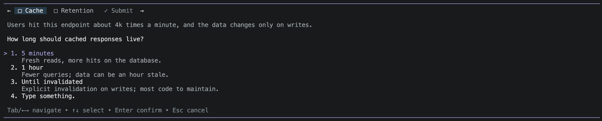

# pi-task

`pi-task` is a standalone [Pi](https://pi.dev/) package. It registers the `pi_task` tool for asking a person questions in Pi's terminal UI.

Install from npm with `pi install npm:pi-task`, then restart Pi or reload extensions. To work from a checkout instead, run `pi install /absolute/path/to/pi-task`; to load one extension file for a single session without changing settings, use `pi -e /absolute/path/to/extensions/index.js`. For an isolated installation, set `PI_CODING_AGENT_DIR` to a fresh directory on every command.

Call `pi_task` with `questions`, an array of 1–4 objects. Each object has a `question`, a `header` of at most 12 characters, an optional `context` of at most 600 characters, an optional `multiSelect` flag (default `false`), and 2–4 `options`. Each option has a unique `label` and an optional `description`.

```json
{"questions":[{"header":"Layout","question":"Which layout should we use?","options":[{"label":"Grid","description":"Compare items side by side."},{"label":"List","description":"Read item details in order."}]}]}
```



Use the arrow keys and Enter to select an option. Select **Type something.** to enter your own answer. A single answer submits immediately. For multiple questions, use the tabs and choose **Submit** when all are answered. Esc leaves the editor first and cancels the window from the question view.

Set `multiSelect: true` on a question whose options are not mutually exclusive, as in Claude Code's `AskUserQuestion`. The options become checkboxes: Space or Enter toggles the highlighted one, and **Type something.** adds a typed answer next to the checked options (Enter edits it, Space clears it). Enter on the **Submit** row (**Next** when there are several questions) confirms the question; at least one option or a typed answer is required. In a tabbed window the Submit tab shows exactly what is checked.

```json
{"questions":[{"header":"Platforms","question":"Which platforms should it support?","multiSelect":true,"options":[{"label":"macOS"},{"label":"Linux"}]}]}
```

`details` and `structuredContent` contain the same result. `content` contains its readable text. `submitted` includes an ordered `answers` array of `{header, kind, label}`. `kind` is `option` or `text`; for a `multiSelect` question it is `multi`, `label` is the picks joined with `, `, and `selections` is an array of `{kind, label}` (`option` or `text`) in option order with the typed answer last. `cancelled`, `aborted`, `no-ui`, and `invalid` all return an empty `answers` array. The caller interprets the answer and decides whether it constitutes approval.

An older orca-pod setup extension may still register `orca_pod_ask`. Both tools can coexist. Package and unit checks use `npm test`; the independent JavaScript tests require Node 18 or later.

See [NOTICE](NOTICE) for attribution and [LICENSE](LICENSE) for licensing.

Verified with Pi 1.4.0 in an isolated agent directory. The terminal smoke covered option selection, free text, cancellation, and coexistence with the older setup extension.
